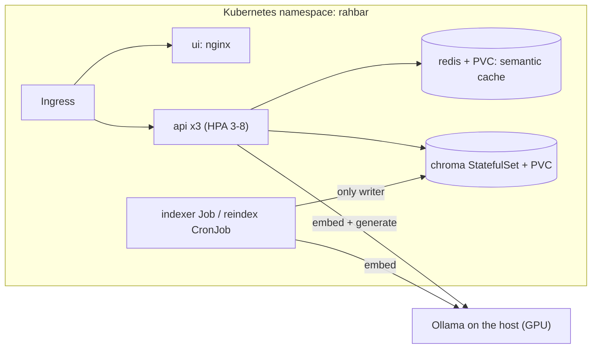
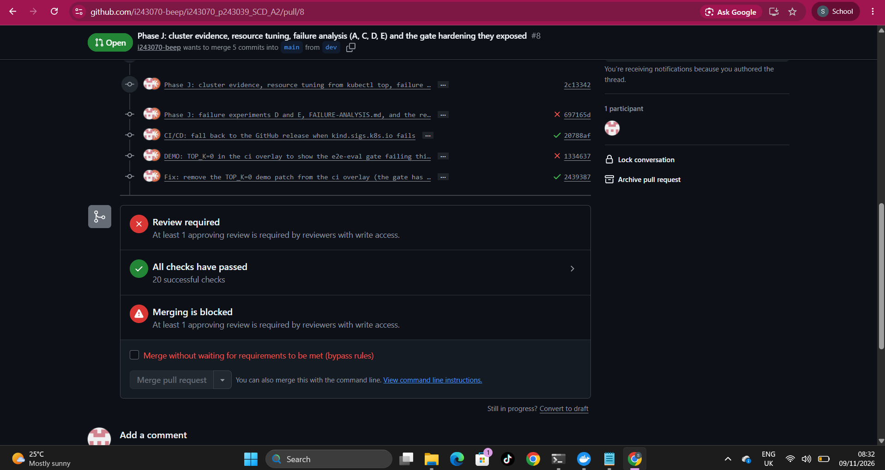

# RAHBAR


[](https://github.com/i243070-beep/i243070_p243039_SCD_A2/actions/workflows/ci.yml)
[](https://github.com/i243070-beep/i243070_p243039_SCD_A2/actions/workflows/cd.yml)

University rules are spread across scanned PDFs, handbooks and web pages, and some of them have been replaced by newer versions. RAHBAR answers questions about FAST-NUCES rules from those documents only: every answer cites the section it came from, a repealed rule is not quoted unless you ask about an older version, and when the documents do not cover a question it says so instead of guessing. It runs on Kubernetes, with an indexer Job as the only writer to the vector store, a three-replica API that only reads, a semantic cache, and a CI gate that blocks a merge when retrieval quality drops.

## Architecture




A question is checked against the cache (keyed by the index id, so a re-index invalidates it), embedded, and retrieved from Chroma (top 5, with superseded documents filtered out, plus an exact-text lookup for clause numbers). Below a relevance floor it abstains without calling the model. Otherwise the model answers in a schema-constrained JSON format, and the code checks that every citation matches a retrieved chunk.

The merge gate working, red on a bad change and green after the fix ([red](docs/evidence/gate-fails.png), and below):



## Results

Measured on the live cluster with `llama3.2:3b` and 21 golden questions (`eval/results.json`, `eval/baseline.json`).

| Metric | Value |
| --- | ---: |
| recall@5 | 0.889 (exact 1.00, ordinary 0.90, version 0.75, injection 1.00) |
| Citation validity | 100% |
| Abstention on must-abstain questions | 100% |
| Superseded document in the top 5 | 0% |
| Answerable questions answered with a citation | 65% (11 of 17) |

**Known limits.** A 3B model declines six answerable questions; they abstain rather than guess. The relevance floor clears the hardest must-abstain question by only 0.001. One GPU serves everything, so parallel questions queue, and with four in parallel on an 8 GB PC the system failed (`docs/FAILURE-ANALYSIS.md`).

## Prerequisites

- Docker, `minikube`, `kubectl`, `make`, and Python 3.12 with `venv` (`python3.12-venv` on Ubuntu). On Windows, use WSL 2 with Docker Desktop's WSL integration on.
- [Ollama](https://ollama.com) on the host, with the models pulled, listening on all interfaces:

```bash
ollama pull llama3.2:3b
ollama pull nomic-embed-text
OLLAMA_HOST=0.0.0.0 ollama serve          # Windows Command Prompt: set OLLAMA_HOST=0.0.0.0 && ollama serve
```

Generation goes through `ollama-host`, and embeddings go through the same host. 8 GB of RAM is the bare minimum: close browsers before indexing.

**Docker Desktop only:** the manifests reach Ollama at `192.168.65.254`, which is Docker Desktop's route to the host, in `k8s/base/configmap.yaml` and `k8s/base/networkpolicy.yaml`. On native Linux, replace that address with your host's address in both files.

## From a clean clone to an answered question

The documents are not committed. `corpus/MANIFEST.md` lists each URL with its SHA-256 checksum, and `make fetch` downloads them.

```bash
git clone https://github.com/i243070-beep/i243070_p243039_SCD_A2.git
cd i243070_p243039_SCD_A2

make install                                # 1. create .venv
make fetch                                  # 2. download the 9 documents to corpus/raw
make cluster                                # 3. start minikube with Calico, metrics-server and ingress
make images                                 # 4. build the three images (the corpus goes into the indexer) and load them

kubectl apply -k k8s/overlays/prod          # 5. namespace, config, chroma, redis, api, ui, ingress, the indexer Job
kubectl -n rahbar wait --for=condition=complete job/indexer --timeout=1800s      # 6. about 7 minutes (OCR, then embedding)
kubectl -n rahbar rollout status deployment/api --timeout=300s                   # 7. /readyz is 503 until the index exists

kubectl -n ingress-nginx port-forward svc/ingress-nginx-controller 8088:80 &     # 8. reach the Ingress
curl -s -X POST http://127.0.0.1:8088/api/ask -H 'Host: rahbar.local' \
  -H 'Content-Type: application/json' \
  -d '{"question":"What is the minimum CGPA an undergraduate student needs to avoid academic warning?"}'
```

For the chat page, add `127.0.0.1 rahbar.local` to your hosts file and open <http://rahbar.local:8088>.

Applying the manifests again over a finished indexer Job fails with `field is immutable`. Run `kubectl -n rahbar delete job indexer` first, and note that applying then re-indexes.

To run the indexer again without a redeploy:

```bash
kubectl create job --from=cronjob/reindex reindex-1 -n rahbar
```

### Secrets

No secret is in Git, and `ollama-host` needs none. For the optional hosted provider, the key goes straight into the cluster:

```bash
kubectl create secret generic rahbar-secret -n rahbar --from-literal=LLM_API_KEY="$LLM_API_KEY"
```

## API

| Method | Path | Purpose |
| --- | --- | --- |
| GET | `/healthz` | Liveness: is the process alive? Touches no dependency. |
| GET | `/readyz` | Readiness: Chroma reachable, collection non-empty, embedding model matches, Redis reachable. Otherwise 503 naming what failed. |
| GET | `/metrics` | Prometheus: requests, latency, retrieval and generation time, cache hit ratio, abstentions, fallbacks, tokens. |
| POST | `/api/ask` | Takes `{"question": "..."}` (3 to 500 characters). Returns the answer, citations, `answered_from_context`, confidence and the retrieved chunks. |

Through the Ingress, `/api/ask` is the public path.

## Develop and evaluate

```bash
make test                                    # stubs only: no cluster, no model
make lint                                    # ruff and mypy
python eval/run_eval.py --api http://127.0.0.1:8088 --host rahbar.local     # score the golden set and apply the gate
```

CI (`ci.yml`) runs lint, tests, manifest validation, builds, a Trivy scan, and an end-to-end evaluation on a kind cluster. CD (`cd.yml`) publishes images tagged with the commit SHA and deploys them to an ephemeral cluster with a smoke test through the Ingress.

## Documents

| Document | Contents |
| --- | --- |
| [`docs/ARCHITECTURE.md`](docs/ARCHITECTURE.md) | The system in detail |
| [`docs/PIPELINE.md`](docs/PIPELINE.md) | Every stage, with measurements |
| [`docs/CORPUS.md`](docs/CORPUS.md) | The documents and the version pair |
| [`docs/FAILURE-ANALYSIS.md`](docs/FAILURE-ANALYSIS.md) | Four stages broken on purpose |
| [`docs/ENGINEERING-NOTES.md`](docs/ENGINEERING-NOTES.md) | The seven questions |
| [`docs/adr/`](docs/adr/) | Architecture decisions |
| [`docs/AI-USAGE.md`](docs/AI-USAGE.md) | What AI wrote, and where it was wrong |
| [`docs/evidence/`](docs/evidence/) | kubectl output, logs, metrics, screenshots |
