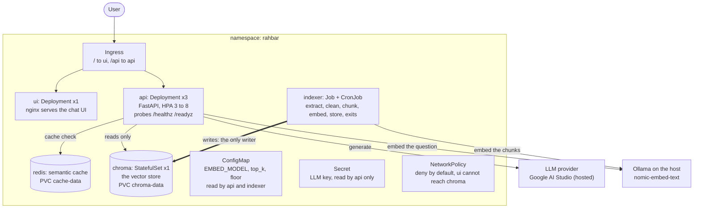

# Architecture

RAHBAR answers questions only from a document corpus, cites its sources, and runs on Kubernetes in the
namespace `rahbar`. Two paths never share a process: an **indexer** that writes the vector store, and an **API**
that only reads it. One sentence explains almost every decision below: *indexing runs once, and again when the
material changes; querying runs on every question.*

## Components

| Object | Kind | Purpose |
| --- | --- | --- |
| `ui` | Deployment x1 | nginx serving the static chat page, non-root, read-only filesystem |
| `api` | Deployment x3, HPA 3 to 8 | the only component that answers questions; reads Chroma and Redis, never writes the index |
| `chroma` | StatefulSet x1, PVC `chroma-data` | the vector store (server `chromadb/chroma:1.0.12`, the same version as the client pin) |
| `redis` | Deployment x1, PVC `cache-data` | the semantic cache |
| `indexer` | Job, and CronJob `reindex` weekly | extract, clean, chunk, embed, store, then exit; the only writer |
| `rahbar-config` | ConfigMap | one place for `EMBED_MODEL` and every tunable, read by api and indexer |
| `rahbar-secret` | Secret (created by `make secret`) | the LLM key; the committed manifest is a placeholder |
| NetworkPolicies | default deny plus allow-list | the ui cannot reach Chroma; Chroma accepts only the api and indexer; Redis only the api |

## Why Chroma is a StatefulSet and not a Deployment

The vector store owns data that must survive restarts and must never be written by two processes at once.

* A StatefulSet gives the pod a stable identity and its own PersistentVolumeClaim from `volumeClaimTemplates`
  (`chroma-data-chroma-0`). The claim follows the pod across restarts and rescheduling, so the index survives.
* A Deployment rolls out by starting a new pod before removing the old one. With a ReadWriteOnce volume that means
  two pods trying to use one volume, or a new pod stuck waiting for the old one. A StatefulSet replaces its single
  pod in order, so only one process owns the volume at any time.
* Chroma is not scaled horizontally here (replicas 1). The API is what scales; the store is the single source of
  truth, which is also why exactly one component, the indexer Job, is allowed to write to it.

## Decisions that follow from "index once, query every time"

* **The indexer is a Job, not API startup.** Three API replicas indexing on startup would be three writers racing
  one volume, a full re-index on every restart, and a readiness probe that lies (ADR 0001).
* **One shared pin.** `EMBED_MODEL` lives in one ConfigMap key. The indexer also writes the model name and the vector
  dimension into the collection metadata, and the API compares them with its own `EMBED_MODEL` at startup and refuses
  to become ready on a mismatch. A rule in a README is broken in week nine; a guardrail makes the broken state
  unreachable.
* **Three probes with different jobs.** `startupProbe` and `livenessProbe` call `/healthz`, which touches no
  dependency, so a slow Chroma can never cause a restart storm. `readinessProbe` calls `/readyz`, which checks that
  Chroma is reachable, the collection is non-empty, Redis is reachable and the embedding model matches. Readiness
  protects users; liveness protects the pod.
* **Re-index without a redeploy:** `kubectl create job --from=cronjob/reindex manual-reindex-1 -n rahbar`. The new
  index is built under a temporary collection name and swapped in only when complete, so the API keeps serving the
  old index until the new one is ready.
* **The cache is invalidated by re-indexing.** The indexer writes a fresh `index_id` into the collection metadata and
  the API prefixes every cache key with it, so a new index never serves old answers and the indexer never needs
  network access to Redis (ADR 0003).

## Query path (every question)

1. Receive and validate the question (3 to 500 characters).
2. Check the semantic cache (skipped for follow-ups).
3. Embed the question with the pinned model and the `search_query: ` prefix.
4. Retrieve the top-k chunks from Chroma, excluding superseded documents unless the user asks about an older one.
5. Abstain when nothing clears the relevance floor.
6. Augment: instructions, then numbered, delimited evidence, then the question.
7. Generate a schema-constrained answer at low temperature, validate it, retry once, then fall back to a safe reply.
8. Check that every citation matches a chunk that was actually retrieved; store the turn and, if safe, a cache entry.

## Security

Per workload: a dedicated ServiceAccount with no API token mounted, `runAsNonRoot`, `readOnlyRootFilesystem`, all
capabilities dropped, and a `/tmp` emptyDir as the only writable path. Network: deny by default, then only the paths
above, plus DNS, Ollama on the host, and HTTPS to the hosted LLM from the api. Secrets: only a placeholder is committed;
the real key is created from an environment variable by `make secret` and, for CI, from a GitHub Secret.

## Observability

JSON logs to stdout with a `request_id` on every line; Prometheus metrics at `/metrics`; one log line per request with
`top_k`, the retrieved chunk ids and scores, and whether the answer was an abstention.
